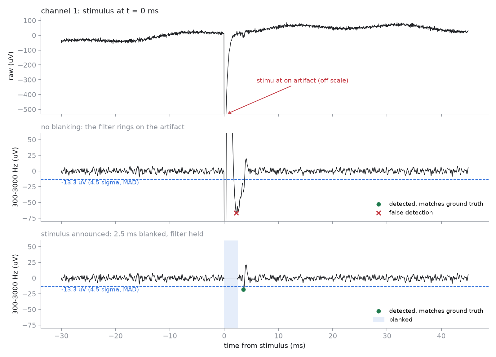

# spikeloop

[](https://github.com/Arihanth-Mutha/spikeloop/actions/workflows/ci.yml)


**Real-time spike detection for multi-electrode arrays, in Rust, with Python bindings.**

Closed-loop experiments on cultured neurons (stimulate, read the response, decide,
stimulate again) need spikes within a millisecond, and every stimulus throws a
voltage artifact hundreds of times larger than a spike onto every electrode. spikeloop
turns raw MEA voltage into peak-aligned spikes as it streams in. It band-passes each
channel, sets robust per-channel thresholds, and blanks stimulation artifacts so a
stimulus never registers as a burst of spikes.



*A stimulus at t = 0. Unblanked (middle), the band-pass filter rings on the artifact
and the detector reports a spike that never happened. Blanked (bottom), the filter is
held at its steady state through the artifact and resumes without a transient, so the
evoked spike 3.5 ms later is still caught. Generated by [`bench/figure.py`](bench/figure.py).*

## Numbers

64 channels, 25 kHz, 10 s synthetic recording (5,560 ground-truth spikes, 8 stimuli),
one core of an Apple M4 Pro. Reproduce with `cargo run --release --example evaluate`
and `python bench/compare_scipy.py`.

| Artifact handling | Precision | Recall | F1 | Detections inside artifact windows |
|---|---|---|---|---|
| none | 0.988 | 0.995 | 0.991 | **737** |
| automatic (any \|raw\| > 500 µV) | 0.992 | 0.997 | 0.995 | 0 |
| stimuli announced by the host | **0.993** | **0.999** | **0.996** | 0 |

| Chunk | Rust core | From Python | NumPy/SciPy pipeline* | Speed-up |
|---|---|---|---|---|
| 1 ms (25 frames) | 3.3 µs · 307× real time | 4.1 µs · 243× | 29.0 µs · 35× | **7.0×** |
| 10 ms | 32 µs · 311× | 33 µs · 301× | 158 µs · 63× | 4.8× |
| 100 ms | 323 µs · 309× | 322 µs · 310× | 1,415 µs · 71× | 4.4× |

\* The SciPy reference does *less* work: `sosfilt` with carried state, a fixed MAD
threshold and crossings with a refractory period. It has no peak alignment, no adaptive
noise tracking and no blanking. Throughput is ~490 M samples/s and does not depend on
chunk size: one sample per call costs the same per sample as a 100 ms block, which is
what a closed loop needs.

## Install

```bash
# Python (builds the Rust extension; needs a Rust toolchain)
pip install maturin
cd crates/spikeloop-py && maturin develop --release

# Rust
cargo add spikeloop-core --git https://github.com/Arihanth-Mutha/spikeloop
```

## Use it

### Python, streaming

```python
import numpy as np
import spikeloop as sl

det = sl.Detector(n_channels=64, sample_rate=25_000)   # sensible MEA defaults

for chunk in stream:                    # (n_frames, 64) float32, microvolts
    if about_to_stimulate:
        det.stimulate(det.frame + 5)    # blank 2.5 ms from that frame
    spikes = det.process(chunk)         # GIL released while it runs
    rates = spikes.counts(64)           # per-channel counts for this chunk
```

### Python, whole recording

```python
data, truth, stims = sl.synthesize(n_channels=64, duration_s=10)   # test signal + ground truth
spikes = sl.detect(data, 25_000, stim_frames=stims)
sl.score(spikes, truth, tolerance=10)   # {'precision': 0.99..., 'recall': 0.99..., ...}
sl.bandpass(data, 25_000, blank=[(s, 63) for s in stims])          # what the detector sees
```

### Rust

```rust
use spikeloop_core::{Config, Detector};

let mut det = Detector::new(Config::new(64, 25_000.0))?;
let mut spikes = Vec::new();
det.stimulate(stim_frame);
det.process(&interleaved_chunk, &mut spikes)?;   // frame-major: [f0c0, f0c1, ..., f1c0, ...]
```

## How it works

```
raw frame ─▶ artifact check ─▶ band-pass ─▶ noise tracker ─▶ threshold ─▶ peak window ─▶ refractory ─▶ spike
             (|x| > 500 µV or    300–3000 Hz   median(|x|)/0.6745  4.5 σ        0.5 ms         2 ms
              announced stimulus)  Butterworth   warm-up + O(1) tracking
                   │
                   └─▶ blank 2.5 ms: hold the filter at its steady state, freeze noise, cancel open events
```

- **Band-pass:** 2nd-order Butterworth high-pass and low-pass biquads (transposed
  direct form II). Identical to `scipy.signal.butter(..., output="sos")`, and a test
  checks it against SciPy.
- **Structure-of-arrays state.** Filter state for all channels sits in contiguous
  arrays, so the per-frame loop over channels has no cross-channel dependency and
  compiles to SIMD.
- **Robust noise.** `sigma = median(|x|) / 0.6745` (Quiroga et al., 2004) is computed
  exactly over a 250 ms warm-up. After that a multiplicative stochastic-quantile update
  tracks slow drift in O(1) per sample, with no buffers and no sorting on the hot path.
- **Artifact blanking that does not ring.** Zeroing the input during an artifact makes
  a high-pass filter ring when real data resumes. spikeloop sets each biquad to the
  steady state it would reach if the current raw value had been constant forever. When
  blanking ends, the filter is already settled on the true baseline.
- **Peak alignment and dead time.** A crossing opens a 0.5 ms window, and the spike is
  reported at its extremum. A 2 ms dead time follows. Band-passing turns a biphasic
  spike triphasic, and with only 1 ms the third phase is detected as a second spike.
  On the benchmark above, that one setting moved precision from 0.60 to 0.99.
- **Chunk invariance.** All state carries across calls. A test feeds the same
  recording in chunks of 1, 25 and 997 frames and requires identical output.
- **Zero dependencies** in the core crate. The synthetic generator uses its own
  xoshiro256++ PRNG, so recordings are identical on every platform.

## Validation

- **Rust: 17 tests.** Filter response at the cutoffs, out-of-band rejection, hold →
  resume without a transient, MAD robustness to spikes, noise tracking, peak alignment,
  refractory behaviour, blanking (announced and automatic), chunk invariance,
  precision/recall above 0.98 on synthetic data, and evoked spikes recovered right after
  blanking.
- **Python: 10 tests.** Accuracy, 1 ms streaming equals one call, filter matches SciPy,
  input validation, dtype and memory-order handling, and the GIL released across threads.
- CI runs the Rust tests on Linux and macOS and the Python tests on 3.9, 3.12 and 3.13,
  plus `clippy -D warnings` and `rustfmt --check`.

## Prior art

Real-time spike detection with stimulation-artifact handling on MEAs has been solved in
the literature for two decades, and spikeloop does not claim a new algorithm.

| Work | What it does | How spikeloop relates |
|---|---|---|
| [MeaBench](https://people.biology.ucsd.edu/dwagenaa/abstracts/05-WDP.html) (Wagenaar, DeMarse & Potter, 2005) | Open-source toolset for real-time MEA acquisition, spike detection, artifact suppression and closed-loop stimulation | The same job. spikeloop is an embeddable library (Rust core, Python bindings) rather than an acquisition application |
| [SALPA](https://doi.org/10.1016/S0165-0270(02)00149-8) (Wagenaar & Potter, 2002) | Subtracts the artifact with local cubic fits: under 2 ms of dead time, in real time on 60 channels at 25 kHz | **Better artifact handling than spikeloop's 2.5 ms blanking.** Not implemented here yet |
| [NeuroRighter](https://doi.org/10.3389/fnins.2010.00031) (Rolston, Gross & Potter, [2009](https://doi.org/10.3389/neuro.16.012.2009), 2010) | Open-source closed-loop recording and stimulation hardware and software | A complete system; spikeloop is one component |
| [Mena et al., *PLOS Comput Biol* 2017](https://doi.org/10.1371/journal.pcbi.1005842) | Gaussian-process artifact model and evoked-spike detection on 512 electrodes | Far more sophisticated artifact modelling |
| [Quiroga et al., *Neural Computation* 2004](https://doi.org/10.1162/089976604774201631) | The median-based noise estimate | Used directly for thresholds |
| [SpikeInterface](https://doi.org/10.7554/eLife.61834) (Buccino et al., 2020) and [Herding Spikes 2](https://doi.org/10.1016/j.celrep.2017.02.038) (Hilgen et al., 2017) | Peak detection and spike sorting, processed in chunks, for offline and dense-array use | spikeloop streams with identical output at any chunk size, down to one sample. It does not sort |
| [MEArec](https://doi.org/10.1007/s12021-020-09467-7) (Buccino & Einevoll) | Realistic simulated MEA recordings with ground truth | spikeloop's synthetic generator is far simpler; MEArec would make a stronger benchmark |
| Device APIs such as Cortical Labs' [cl-sdk](https://pypi.org/project/cl-sdk) | Some platforms hand applications spikes that are already detected | spikeloop matters when you work from raw voltage |

What spikeloop contributes is engineering: a dependency-free Rust core with Python
bindings that release the GIL, output that is identical for any chunk size, a filter held
at steady state through blanking so it cannot ring, and published accuracy and latency
measurements with the code to reproduce them.

## Context

I built spikeloop alongside wetloop, a
development platform for living-neuron computers. A wetloop step stimulates, waits
`artifact_wait_ms`, then collects spike counts per channel. That wait exists because of
exactly the artifact problem shown above. spikeloop is standalone and has no
dependency on wetloop or any hardware SDK.

## Limitations

- **Validated on synthetic recordings only.** It has not been run on recordings from a
  real culture yet, and real artifacts, drift and multi-unit activity are messier.
- Causal filtering distorts waveform shape. Detected peaks are on time (median offset 0,
  95% within 0.04 ms of the true trough on synthetic data), but if you need the
  waveform itself, re-extract it with offline zero-phase filtering.
- Detection only, no spike sorting. Blanking is global across channels, which matches
  how a stimulus artifact couples onto an MEA but wastes time on distant channels.
- The 2 ms dead time hides genuine spikes that follow within 2 ms on the same channel.
- Blanking throws away 2.5 ms after every stimulus. SALPA-style artifact subtraction (see
  Prior art) recovers spikes sooner and is the obvious next step.

## License

Apache-2.0
